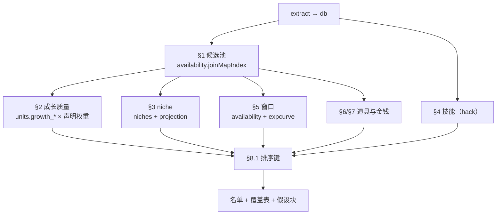

# 阵容推荐：从一个 ROM 到一份可审阅的名单

输入一个 ROM，输出一份排序名单、每人的理由、稀缺能力覆盖表、一份声明过的假设清单。不产出战斗模拟，不承诺通关。

整份答案的通货是假设。策略选择要写出来，从表里读出的数字和算出来的数字要分开。仓库里已有的声明形状见 `src/analysis/expcurve.ts` 的 `meta.assumptions`，照它做。



## 0. 先有产物

所有命令从仓库根跑，`node` 需要 22.18 以上，输出是 JSON。

```bash
node src/index.ts extract <rom.gba> --out <db>
```

一个 db 对应一个 ROM，是全量重建的快照。解析一次，之后全部读 db，不为每个问题重新解 ROM。表与契约见 `src/repository/schema.ts`，两条流程见 `docs/architecture.md`。

extract 若告警「N/M event scripts contain unknown instructions or stopped without an exit; event-derived results are partial」，把行数写进答案，并说明事件派生的事实是上界。告警只写 stderr，`extract` 的 JSON 里没有 warnings 字段，所以输出不要经过 `| tail` 截断。这条告警和 `node:sqlite` 的 `ExperimentalWarning` 共用 stderr，重定向时要把 stderr 存到文件再筛；`2>/dev/null` 会把两者一起吞掉。

每个 DB 命令在结束时也会重放这次会话实际触发的诊断（同一句 partial 告警、以及被排除的 debug map 列表）。只有读事件的命令才可能触发 partial，只读单位和职业的命令不会。诊断块的内容取决于本次跑了哪些命令，单看它判断不了整个 db 是否完整。

`node src/index.ts --help` 与 `node src/index.ts <command> --help` 是命令与参数的权威清单，下面引用的命令名、flag 名都以它为底。

开头核对规模，看四个数，它们互不能替代：

| 量                     | 含义                                                    |
| ---------------------- | ------------------------------------------------------- |
| `roster` 行数          | `has_support_data = 1` 且非空的单位数（就是名册的定义） |
| `joins` 的 join 行数   | 真正进入玩家军的单位数                                  |
| `\|roster \ joiners\|` | 名册里永不入队的人数                                    |
| `\|joiners \ roster\|` | 名册外的入队者数                                        |

后两个按集合差算。`roster − joiners` 只是一个数，既可能与「永不入队」不等，也可能为负。两个方向各自说明一件事：名册外有入队者，说明这个 ROM 的可操作单位不在 support 表里，池子要改用入队者；名册里永不入队的人多，说明名册里掺了不可用的头像槽。两者都出现也很常见。

`joins` 对每个**露过面**的单位最多出两行：`kind="join"`（最早进玩家军）与 `kind="appearance"`（最早露面的章）。两行都是每单位至多一条，所以入队行数只数 `join` 行；单位数也不能用 `总行数 / 2` 反推（只露过面、从未入队或只在 debug map 露面的单位只有一行）。`appearance` 的来源包含路人、敌人、NPC。

## 1. 候选池用入队者，不用名册

```bash
node src/index.ts joins <db>         # join（最早进玩家军）与 appearance（最早露面）
node src/index.ts availability <db>  # joinPosition / joinMapIndex / availableCount / gaps / joinUnresolved
```

池子一律用命令取。可达性遍历住在 `src/analysis/appearances.ts`，包含布阵块、可达 load 点、recruit 判定与 debug 图排除，手写 SQL 会数出另一个数。

「入队」的判据在 `isPlayerArmyAppearance` 里只有两条：玩家侧的布阵记录（`source` 为 `placement`），或 `recruit`（LOAD1 一类）且阵营为玩家或友军。`load` / `cutscene` 的加载不构成入队，与阵营无关。

`availability` 对所有见证过的单位出行，含敌人与 NPC。入队者取 `joinMapIndex` 非 null 的那批。两个字段会分叉：在播放序外地图上入队的单位有 `joinMapIndex`，`joinPosition` 为 null；按前者取不会漏人。

`joinMapIndex` 为 null 的单位分两种，靠 `joinUnresolved` 区分：

- `joinUnresolved` 为 null，是确认不入队。这类不进池子。
- `joinUnresolved` 非 null，是判不出。取值有两种：
  - `recruit-from-enemy`：唯一像入队的证据是敌方侧 `LOAD1`。原版用这条指令表达「说得敌方单位」，hack 也拿它当普通生成器。
  - `load-only`：单位在玩家侧出现过，但只有 `LOAD2`/`LOAD3`，没有任何一条记录把它加入队伍。脚本之后会移交。
    这两类都按「可能入队」处理：写进答案的限制段，不参与窗口折价，也不自己补一个入队点。

这两类单位有 support data、有头像，`joinMapIndex` 却为 null。要区分「判不出」与「不入队」，唯一依据是 `joinUnresolved`；单看 `joinMapIndex` 会把两者混成一种。

`derived_play_order` 是单条路线的线性化，外传按插入点拼接，其他分支只留在 `meta`。所以 `joinPosition` 为 null 而 `joinMapIndex` 非 null 的单位，可能只在另一条线入队，也可能是入队点根本不在转场图的可达部分里。用 `transitions` 当有向图、以播放序的章为种子做可达闭包，方向是「主线到目标图」。闭包到不了的单位确实有 join 行，答案里写「离线入队，转场图无入口」。

## 2. 成长质量按分布加权

```sql
SELECT id, name, growth_hp, growth_str, growth_skl, growth_spd,
       growth_def, growth_res, growth_lck
FROM units WHERE has_support_data = 1 AND class_id <> 0 ORDER BY id;
```

不要按 `growth_total` 排序，改用下面的加权和。总量有方差但分布错位时，同一个总数可以堆在幸运上，也可以堆在攻防速上，排序结果完全不同。总量被归一化时（有些 ROM 把成长总量压成常量，若干单位的 `growth_total` 完全相同），它连区分度都没有。

判据是 `SELECT COUNT(DISTINCT growth_total), MIN(growth_total), MAX(growth_total) FROM units WHERE has_support_data = 1 AND class_id <> 0`。两种形态的结论一样：只用加权和。

注意 `growth_*` 是**单位自己的成长**（`tables/units.ts` 的 `+28..34`），与敌人用的职业成长（`classes.enemy_growth_*`）分属两张表。`roster` 命令已经排除了空单位；直接写 SQL 时则要自己加非空条件（空单位槽也带一行）。

得分是七个成长列的加权和。权重是策略而非数据，必须在答案里声明。默认起点：spd 1.2、str 1.0、skl 0.8、def 0.8、res 0.5、hp 0.4、lck 0.1。改动权在用户。

成长描述轨迹，终点交给 `projection`。cap 分步生效，自己算会与 `maxed` 对不上。

两个界的差是「还剩多少成长空间」，记为 `headroom = Σ(maxed) − Σ(startingStats)`，两项都取 `projection`。`startingStats` 是精确值（class base + unit delta），`maxed` 已经包含转职加成与 cap 截断，所以 `headroom` 只能由这两个输出相减。它和加权成长率经常分歧，而且分歧是真结论：入队已接近满级、或已转职到终位的单位成长分可能很高，`headroom` 却接近 0。只看成长分会把已经练满的人排到最前。`headroom` 单独作排序键也有偏差：它奖励低等级入队的人，而这些人未必还有训练窗口。

`maxed` 是终局上限，不是期望值，也不是概率。它按「当前职业从入队等级长到 20，拿转职加成，在终位职业上再长到 20」算，每一步的成长率都按满额计入，所以带小数。源码的措辞是 every growth succeeded, exactly, not a probability, and not a plan。引用这个块时按上限叙述并在假设块声明它是上界。

转职是可选的一步：`projection` 不建模「一直不转职」的分支，所以对能转职的单位，`maxed` 是转职后的上限，`headroom` 描述的是「把转职也用上」还剩多少空间。若全局拿不到转职道具（§6），实际上限低于这张表，要写进限制段。

`maxed` 只给 class id 最小的那条分支，每条分支各自的上限在 `maxedByBranch` 里。按属性跨分支取最大值会拼出一个不存在的单位。

`maxedByBranch` 为空是一个可判定的状态：该单位当前职业没有出边，入队时就处在终位。这时 `maxed` 本身是对的，它是当前职业从入队等级长到 20 的上限，没有基础段。

`classLine` 会把这类单位的基础职业排在前面，形如 `Cavalier > Paladin`，读起来像「还能从 Cavalier 走到 Paladin」，实际上这是它入队前走过的路。入队后还有没有得转，看 `maxedByBranch` 是否非空；`classLine` 的项数与之无关。`class_branches` 的子节点同样回答不了这个问题，它描述的是职业的子节点。

`promotedAtJoin` 的含义是「单位自身标记为已晋升」且「当前职业无出边」，源码是 `!hasPromotion && unit.isPromotedClass`。单位表没标已晋升、但也没有出边的职业会给 `false`；这个字段为 `false` 时，转职余地仍然看 `maxedByBranch`。

## 3. 职业差异化：练一个单位的理由是它的 niche

```bash
node src/index.ts niches <db>          # 每个 niche：武器集、职业数、能到达它的入队者
node src/index.ts projection <db>      # 每单位的 classLine / maxed / maxedByBranch / promotedAtJoin
node src/index.ts roles <db>           # 每个职业的 mobility 分类
```

`projection` 覆盖名册与入队者的并集。两个集合在真实 hack 上谁也不包含谁，名册里有人永远不入队，入队者里也有人不在名册。两者都在输出里，交集才是候选池：先用 `availability` 的 `joinMapIndex` 非 null 过滤。

反过来，入队者漏出 `projection` 只有一种情形：它不是 `analysis/appearances.ts` 认定的玩家军入场（比如只在调试图或只以 `load`/`cutscene` 出现），而那正是候选池本来就要排除的。所以对想推荐的人，出现「有 joiner 却无 projection 行」先回头查他到底是怎么被算进 joiners 的，而不是写一个「无上限数据」就此交差；真的没有任何行时，把他从名单剔除并写进限制段。从 `classes` 表重算上限会绕开 cap 分步、转职加成与 `+5` 仲裁，结果与 `maxed` 对不上。

`niches` 的排序是四键：`joinerCount` 为 0 的垫底，然后 `joinerCount` 升序，然后 `classCount` 升序，最后按 niche 字符串。开头那批就是结构性独占。

`joinerCount === 1` 不自动构成理由，要先看 `classCount`。无武器职业会让 `none|normal` 这类行有二三十个职业，却只剩一个入队者可达，它是最不稀缺的能力。值得写成理由的结构性独占是 `joinerCount === 1` 且 `classCount === 1`。`classCount` 大而 `joinerCount` 小，说明那些职业实际是敌方或 NPC 专用，属于玩家侧拿不到的选择。

`joinerCount > 0` 也不等于「可以练进去」。唯一的可达者可能入队即终位（`maxedByBranch` 为空，见 §2），那个 niche 是既成事实，不构成「练他」的理由。读 `niches` 的 `joiners` 时要配合 `projection.maxedByBranch`，否则会把已转职的人写进推荐理由。

可达性只沿转职图走最多 4 层，所以 `joinerCount` 是下界：更长的链（四级以上）不会被跟到。这不影响单次转职的结论，但 `joinerCount === 0` 只代表四层内无人可达，不能作为「无人可达」的证明。

注意 `niches` 输出的 `classCount` 已经按 profile 合并：职业表里同名同 profile 的重复条目算作一行。所以它有「看起来重复其实是一个 niche」这一面；但如果你要在 niche 内部比较具体职业（比如两个都能骑马用剑的职业），就得自己按 `class_id` 展开 `classIds`。这里的连接与去重一律用 `class_id`，`classes.name` 有重复不可靠。

niche 键的文法是 `武器集|移动方式`，武器之间用 `+` 连接表示同时会（并集），`@xxx` 后缀是该职业的 `special_action`。所以 `axe+bow|normal` 是既能用斧又能用弓的步行职业。

`roles` 只在你要按移动方式统计、而 `niches` 的键粒度太粗时才需要。`niches` 已经把 mobility 编进键里，单纯回答「谁飞」直接读键即可。

一个职业可以同时是转职目标、又是还要再转一次的中间层，所以它在某个 niche 里出现过，并不代表它是终位。判断终位看 `maxedByBranch` 是否为空。

上限集中度：武器集窄、攻击侧上限高的专精职业优于同成长的万金油职业。依据是 `maxedByBranch` 里各分支的 cap，职业名字说明不了这点。

`wl_*` 的数值是武器等级的数值形式，字母是它的另一种表示：`1..30` 是 E，`31..70` 是 D，`71..120` 是 C，`121..180` 是 B，`181..250` 是 A，`251` 以上是 `S`。换算实现是 `src/tables/items.ts` 的 `weaponRankLetter`。CLI 不输出字母，所以直接用数值比大小，`> 0` 即有该武器。常见错误是把 121 读成 C、181 读成 B。

`+5` 的指向不是单向的，转职图统一由 `buildPromotionGraph` 构建。它常常成对互指，字段本身说不出哪端是基础。方向靠 `sortOrder` 仲裁，而 hack 可能不填。处理规则是：分支表当主源，`+5` 仅在两侧都有排序、且它指向的高阶职业不属于分支表的基职业时参与。`niches` 和 `projection` 都已经用它。

`niches` 和 `projection` 都对这张图的守卫做过验证：改成看基础侧会连方向一起颠倒，进而删掉大量真边；改成「分支表已给出该孩子」会放行反向边。所以图本身不需要外部校正，边也不必被判为伪造。想看某个单位到底能转去哪，看它自己的 `maxedByBranch`。

两份数据都无法表达方向时，该职业拿不到转职目标。常见原因是 `+5` 自指，或者排序未填且 `+5` 指向外。舞娘与傍子这类终位职业本来就没有转职。这类单位在答案里标「转职方向未定」，交给人工判断。

## 4. 技能

先看规模：

```sql
SELECT (SELECT COUNT(*) FROM skills) skills, (SELECT COUNT(*) FROM unit_skills) unit_skills,
       (SELECT COUNT(*) FROM class_skills) class_skills,
       (SELECT COUNT(*) FROM unit_skill_learn) unit_learn,
       (SELECT COUNT(*) FROM class_skill_learn) class_learn;
```

全为 0 就是原版 ROM，本节跳过。GBA 三部原版的模型里没有技能。

有行时（hack），三个来源形状不同，要按单位拼：`unit_skills` 是固有技能（一单位至多一个），`class_skills` 是职业静态绑定（一职业至多一个），`class_skill_learn` / `unit_skill_learn` 是分级习得。职业带技能的权重高于单位固有技能，因为职业表现一个单位的定位。

`class_skill_learn.level` 的 255 是哨兵，意为「无等级门槛」（等级一到就学）。有技能系统的 ROM 上这类行往往占一半以上。

四个开关列 `player_only` / `enemy_only` / `both_sides` / `hard_only` 只存在于两张习得表里，不在 `unit_skills` / `class_skills` 里。ROM 没有 class-skill 扩展时它们全为 false，而 `level` 是整个字节（原始值见 `raw_level`）；有扩展时高位才承载这四道门。读它们再决定要不要算进玩家侧的强度，全 false 的含义是「无门控」。

技能是否进排序要显式声明。仓库不给合并规则，所以要么在假设块里写明「技能不进分数，只作定性描述」，要么自己定权重并写出。

## 5. 入队窗口

```bash
node src/index.ts availability <db>                     # 默认只出标量
node src/index.ts availability <db> --full              # 追加逐章状态
node src/index.ts expcurve <db> --actor-level <入队等级>  # 逐章经验带宽
node src/index.ts expcurve <db> --difficulty hard       # 只看一个难度，默认三个都出
```

窗口长度是 `availableCount / totalAfterJoin`，先判 `joinPosition` 再除。`availableCount`、`totalAfterJoin`、`gaps` 在入队章不在播放序上时都是 `null`，三者描述同一件事：主线窗口。

除之前先看 `availability --full` 的逐章状态：它是这份数据里最大的一块，只在问题真的关于某一章时才加，并且重定向到文件。

三者取 `null` 而不取 0 或空数组：0 会被读成没入队，而这些单位确实入队了，只是在播放序没覆盖的地图上；空数组会被读成「入队后一章都没缺」。`joinMapIndex` 为 null 的那一类是永不入队或未定论，已在候选池外；两类只能靠两字段组合区分。

对离线入队的单位，窗口值由模型给出 `null`，自己编一个值会让他们的名次失去可复算性。他们可能在支线、外传，也可能只在跳章菜单里。写进限制段，让他们按成长分和 niche 参评，不按窗口折价。

`gaps` 的元素形状是 `{ fromPosition, toPosition, reason }`。`availableCount` 已经扣过它们。有 gap 的单位里，相当一部分的唯一 gap 就在自己的入队章，所以可用章数会系统性地少算入队那一章。这是 `availability` 的启发式边界，写进限制段即可。

想看经验带宽而非章数时用 `expcurve`。它给每章的 `totalExp` 与 `expectedLevels`，从入队章起累加就是该单位的经验上限。`expectedLevels` 不 clamp 到 20 级，只适合做相对比值。

`--actor-class-power` 默认 3（本次 ROM 职业表 `+26` 的众数），它和 `--actor-level` 一起定义「谁在打」，所以引用数字时两个都要写。`--actor-promoted` 只给有效等级 +20，不建模上位职业的“职业加成 B”；上位攻击方的 power 被低估，反而抬高算出的经验，所以它适合粗略的敏感性对比，不适合当真实满级单位的模拟。

默认值本身是保守端：`--actor-level` 20 是基础职业封顶的最高级，后期真正能涨经验的往往是已转职、重新从低等级出发的单位。比较不同单位时要么统一用入队等级区间，要么统一用默认值，不能一个单位一个值。

`expcurve` 的 `meta.actor` 回显解析后的 `level` / `classPower` / `promoted`，`meta.difficulties` 列出实际出数的难度，`meta.assumptions` 列出未建模的部分。引用数字时照抄这个块，它是唯一能证明某次结论出自哪组参数的记录。

`budgets` 只覆盖 `derived_play_order` 里 `playable = 1` 的章，所以离线入队的单位在 `budgets` 里也没有自己的行，相邻章的数字替代不了它。

难度是一条真轴，结论要按实际跑的参数说。`--difficulty` 只出一个难度，默认三个都出。换难度要重算，另一组参数下的数字不能照搬，同一个晚期入队单位在不同难度下的窗口结论可以反过来。

难度不一定单调。有些 ROM 上 `normal` 的总预算反而低于 `easy`，增量集中在后段章节。所以「难度越高压得越紧」这个推论不成立，结论要按你真正跑的参数说话。

回答前量一下每根轴在本次 ROM 上的区分度。窗口折价经常是空轴：如果池子里 `availableCount / totalAfterJoin` 几乎全为 1，它就没有分辨率，真正有区分度的是 `expcurve` 的剩余预算占比。区间宽度小于成长分相邻差距时，在答案里写「声明了公式，但它没有改变名次」。

## 6. 转职道具：时机与分配

```sql
SELECT id, name FROM items WHERE is_promotion_item = 1;
SELECT item_id, class_id, effect_code FROM item_promotions;
SELECT s.map_index, si.item_id FROM shop_items si
  JOIN shops s ON s.id = si.shop_id
WHERE si.item_id IN (SELECT item_id FROM item_promotions);
SELECT map_index, item_id FROM map_objects WHERE kind = 'chest';
```

把 SQL 写成文件或用 heredoc 跑。单引号 shell 字符串里的单引号会被 shell 吃掉，`kind='chest'` 会变成 `kind=chest` 并报 `no such column`。

先确认这件道具拿不拿得到，再谈分配。每件 `is_promotion_item = 1` 的道具都要把三个来源求并：`shop_items`、`map_objects` 的宝箱（`kind = 'chest'`）、`gains` 的 `items[]`。零结果的写进限制段，当作不可分配资源处理。

宝箱只能证明“地图上有这个道具”，可得性另算：上锁的箱子需要钥匙（`map_objects.kind = 'door'` 与物品里的钥匙类），而 `flag` 非 0 的箱子只能拿一次。报告可得性时把这类条件带上。

事件授予用 `gains` 取，它的 `items[]` 带 `mapIndex` 与 `unitId`。`event_item_grants` 表本身没有 `map_index`，而要自己补一个也走不通：`event_scripts` 到 `chapter_event_slots` 的 join 会双重计数且漏计。同一个 script 可以占多个 slot，也有 script 不属于任何 slot。这不会报错，只会给出一个错的数。`gains` 已经在 `tables/eventTrace.ts` 里做了可达闭包，直接用它的结果。

点名授予要拆开看，并且校验目标能不能用。「点名」指 `unitId` 是真实单位 id：`65535` 是当时行动的单位，`0` 是无指定，`null` 是没有单位字段。有的 ROM 上大半授予都指向具体单位，所以先统计再决定要不要逐条审。

只尊重真正点名的那些，并逐条拿 `units.class_id` 去 `item_promotions.class_id` 里找。目标单位用不了这件道具的情况是存在的，不校验就会在答案里写出一个不可能发生的转职。

`item_promotions.class_id` 的语义是「能用这件道具的基础职业」，与「它能转出的职业」是两回事。验证方式是取一件万能道具（`effect_code` 0x2d，即十进制 45），看它列出的职业是否都是非终位。

注意 `item_promotions` 是按 `staff_effect` 附到**所有共用该码的道具**上的，所以同一行会在多个 `item_id` 下重复出现。按 `item_id` 统计“影响多少职业”时先去重。

终位判据用 `class_branches` 无子女，即 `branch_1 = 0 AND branch_2 = 0`。`classes.promotes_to_class_id` 在这里误导：这个字段在已完成的转职链上会反向指回基础职业，它描述的是「谁是我基础」。`classes` 表也没有 `is_promoted_class` 列，那列在 `units` 上。想要权威答案直接读 `projection.maxedByBranch`。

时机必须先折成 play position，从 `map_index` 到 `derived_play_order.position`。不在播放序里的地图不在主线上，这种道具报「无主线时机」。商店种类推不出时机，每张地图都要真查。`shops.map_index` 也可能为 NULL（备战屏商店，全局可得），这类没有章节时机，按「全局可得」报。

分配规则：道具给「它能用的、niche 最稀缺的、成长质量最高的、窗口还没走完的」单位。窄口径道具（`effect_code` 为 0x19/0x1a/0x1b/0x1c/0x1d/0x2d/0x2f/0x30/0x31/0x32，即十进制 25/26/27/28/29/45/47/48/49/50）给需要那条分支的人；其中 0x2d（45）是万能（领主）道具，单独处理（下段）。`effect_code` 在库里是整数列，直接写 `0x2d` 在 SQLite 里会被当字符串而不匹配，写十进制 45。

万金油供给先查供给量再决定要不要分配。路线多到十几条、覆盖几十个基础职业的，属于日用品，不需要分配决策；路线只有个位数的，才构成真选择。供给充足就照实说，不必臆造一个「谁拿」的权衡。

## 7. 武器与金钱预算

金钱走 `gains` 的 `gold[].mapIndex` 加 `delta`，按 play position 累计。`event_gold` 表没有 `map_index`，理由同上，直接查它得不到章节归属。

价格看 `items.unit_price`，这是每条用量的单价。`items` 表没有 `kind` 列，类别用 `items.type_name`。商店种类在 `shops.kind`（weapon / item / secret / prep，prep 的 `map_index` 为 NULL）。

`items` 表没有 `is_weapon` 列，武器判据是 `tables/items.ts` 的 `isWeapon`，实现为 `type <= 7`。这个阈值只在原版物品类型表上成立，hack 插了物品类型后会误报；换用 `type_name` 或 `item_effectiveness` 反推更稳。

`unit_price` 的单位是「每条用量」，所以买入价是 `shop_items.effective_uses * unit_price`；同一行的 `uses` 是商店列表里写的耐久，0 表示满耐久。两者不一致时，价格必须跟 `effective_uses`。卖出价是买入价的一半。

`unit_price` 是 u16，最高 65535（`tables/items.ts` 直读 `+26`，`schema.ts` 未为此列声明哨兵），把它当成「带 65535 哨兵」的列去筛会漏行。只有两类值得排查：`unit_price = 65535` 的行（可能是 hack 填充的空槽），以及价格与 `type_name` 不相称的行；把它们列出来逐行看。`MAX()` 或 `ORDER BY unit_price DESC` 的首行恰好就是最可能不真实的那一行。价格区间过滤模板：`WHERE unit_price BETWEEN 1 AND 20000 AND name <> ''`，但要把被过滤掉的行数一并报出来。

商店 `kind = 'secret'` 与「卖转职道具的店」是两回事。秘店里可能卖属性药，也可能什么都不卖，还有可能是空表。转职道具与否必须逐店查 `shop_items` 里到底有没有 `item_promotions` 里的道具。

按 play position 累计之前先搞清楚 `delta` 的符号：`gains` 和 `event_gold` 里存的是指令里的带符号增量，负值就是花钱，所以「事件金总额」大于可用现金。

先看主线金里有多少真的在主线上。事件金常常集中在离线地图（塔层、竞技场、试炼），总额可以远高于现金。这两个数都要报，差别往往是十倍以上。具体做法是把 `gold[].mapIndex` 分成两组（`derived_play_order` 里有行 / 没有行），分别求和。

把现金按 play position 累加到具体时点，再和下个商店报价比。只看总额会得出「买得起」的结论，而那个时点未必有这笔钱。典型情形是转职秘店在中期开，而大额事件金要到更后面才到账，那个时点的现金只够买半件。

结论是「第几章买得起什么」。若这条轴全程不咬死，明说它不咬死，也不为它编造一个约束。对照时要算价格乘数量。

## 8. 组装答案

前七节取事实，这一节是判断。失败模式通常出在拼接步骤上：排序键与常量没有可复算的定义时，每个读者会自己发明一套，两份答案就不可比。所以排序键要写成公式，常量要声明。

产出四部分：

1. 排序名单，每人一行理由，点明是哪些轴的数值定了他的位置。
2. 稀缺能力覆盖表：用 §3 的结构性独占（`joinerCount === 1` 且 `classCount === 1`，且唯一可达者不是入队即终位），写明哪些 slot 没填、哪些是 `joinerCount === 0` 的结构空洞。
3. 假设块。
4. 一句模型不承诺什么。

### 8.1 排序键给公式

至少把下列三个量显式算出来并列进名单表，排序键就是在它们上面做选择。

| 量            | 定义                                                          | 来源                        | 回答什么       |
| ------------- | ------------------------------------------------------------- | --------------------------- | -------------- |
| `growthScore` | 七个成长列按声明权重的加权和                                  | `units.growth_*`            | 长得好不好     |
| `headroom`    | `Σ(maxed) − Σ(startingStats)`                                 | `projection`                | 还剩多少可以长 |
| `window`      | `availableCount / totalAfterJoin`，或从入队章起的剩余经验占比 | `availability` / `expcurve` | 还来得及吗     |

默认起点，可以改但改了要写出来：先按「能否到达结构性独占 niche」分层，层内按 `headroom × window` 降序，`growthScore` 只做同分仲裁。

`window` 为 `null`（离线入队）时，代入 0 或 1 都会给这类单位一个未经声明的隐藏权重。把它当作独立的一个排序层（「窗口未定」），或者在假设块里声明代入值与理由。

排序键必须声明，并且落到这三个量上。只写「稀缺优先」不够。报答案时把每人的三个数一起列出来，读者才能自己重排。

### 8.2 先量区分度

每根轴参与排序前先量区间宽度。最常失效的是窗口轴：如果大多数单位的值都贴近上限，它就没有分辨率，这时候起作用的其实是从入队章起的剩余经验占比。某根轴的宽度小于相邻单位的差距时，在答案里写「声明了公式，但它没有改变名次」，并省掉关于这个乘数的篇幅。

### 8.3 声明名单规模

名单该几人没有默认值，但必须声明 N 与理由，因为它直接改变覆盖结论。可行的依据是 `chapters.deploy_slots` / `deploy_slots_hard`（每章上场名额）、`force_sortie` 的强制出击名单，或「覆盖全部结构性独占 niche 所需的最小集合」。同一份分析写「建议 14 人」和写「建议 8 人」是两个答案。

### 8.4 覆盖表算边际

如果排序键以稀缺 niche 优先，「最少几人能覆盖全部 `joinerCount === 1` 的 niche」必然成立，覆盖表就不再是对名单的独立审计。有信息量的是边际覆盖曲线：第 1、3、5、8、12 人各新增哪几个 niche，从第几人起新增为零。写出这条曲线，读者才知道名单在哪里停止增益。

### 8.5 假设块的固定条目

成长权重向量。难度，写成声明过的选择，写明按哪个难度、因为什么，并同时写出 `--actor-level` 与 `--actor-class-power`，因为它们共同决定 `expcurve` 的数字。死亡策略与难度常同时变化，两者要一起写。extract 的 partial 告警行数（没告警就写 0）。窗口折价公式，或者「该轴没有区分度」的结论。

死亡策略必须说清楚它改变什么：本仓库不产出战斗模拟，也没有「永久死亡」的表，所以它只影响你读名单的立场（例如「按不依赖死亡救援的视角」），不会改变任何数字。写出来是为了让读者知道这是一条判断。

随机立场的正确写法是「按确定性上界排序，期望模型不存在，实际成长会低于这张表」。「按成长率期望值」会让人以为排序键是二项分布的均值，而 `maxed` 是每次成长都成功的上界。

三类「没算进去」需要写进假设块：

- `joinUnresolved` 非 null 的单位，按类型分别说明（§1）。
- 入队章不在播放序的单位，没有窗口折价（§5）。
- 只在调试图/非入队类加载里出现的单位，没有进候选池；这类是主动排除，需在限制段声明（§1/§3）。

## 9. 工具用法

这一节里的大部分坑不是“使用者不小心”，而是当前的 API 与表布局把危险默认值推给了调用方。每条都标了**现在怎么用**与**该改什么**：前者是今天就要遵守的，后者是让下一个人不必再读这段的东西。

### 9.1 输出信封

**现在**：裸数组的命令有 `roster`、`joins`、`availability`、`niches`、`roles`、`projection`、`transitions`、`recruits`；`gains` 是 `{gold, items}`；`expcurve` 是 `{meta, budgets}`。先判 `Array.isArray()` 再消费，否则 `j[0]` 会静默得到 `undefined`。

**该改**：`emit` 只做 `JSON.stringify(payload)`，信封由各命令自己拼，所以形状靠约定。建议把信封统一到 `cli/emit.ts` 的 `{ data, meta }` 包装里，由 `Command` 的返回类型约束：分析命令在 `meta` 里带上 `game`、`diagnostics` 与自己的参数回显（`expcurve` 已在做，是今天唯一一份正确的样本）。这样消费方不需要先判类型；`extract` 的 partial 告警也从 stderr 变成 `meta.diagnostics` 里的结构化条目，`2>/dev/null` 吞掉告警的问题一并消失。

`sqlite3` 默认是带框线的表格输出，既不便阅读也不适合喂给排序，一律加 `-list` 或 `-csv`，再按需加 `-noheader`。这是 sqlite3 的接口，不在本仓库的修改范围内。

`node:sqlite` 的 `StatementSync` 只有 `.all()`，没有 `.get()`，取一行用 `.all()[0]`。同上，属于运行时。

### 9.2 已物化的结论不要用 SQL 重拼

**现在**：`projection`、`availability`、`niches`、`gains`、`joins` 都是 `analysis/` 模块的结果，没有对应的表或视图（历史上的 `roster`、`unit_joins` 等视图已删，见 `schema.ts` 模块注释）。`SELECT ... FROM roster` 会报 `no such table`；名册就是 `units WHERE has_support_data = 1`，或直接跑 `roster`。敌人实测属性是唯一物化了的一份，查 `derived_unit_stats`。

**该改**：`analysis/` 里好几个模块的输入就只是几张表的组合（`availability` 只要 units + chapters + play order + trace），把它们重写成 SQL 视图的成本很低。建议给这些派生加 `analysis_*` 前缀的只读视图（如 `analysis_joiner`、`analysis_window`），与 `derived_*` 区分：`derived_*` 是“SQL 算不出来的推断”，`analysis_*` 是“分析时反复用到的平凡连接”。这样“候选池”“窗口”这类高频问题可以直接 `JOIN`，不必把命令输出再导回去；`maxed` 这种带 cap 分步与转职仲裁的仍留在命令里。

### 9.3 输入不可用与合法空集要能当场分开

**现在**：章节或事件输入不可用时，只有读事件的命令才会报错，且报在命令内部（`prepareAnalysis` 的 `requireAvailable`）；直接写 SQL 的人拿到空表，无法区分“这个 ROM 没有事件层”与“提取失败了”。必须先 `SELECT * FROM meta WHERE key IN ('chapters.available','events.available')` 并把 `'true'`/`'false'` 字符串自己转成布尔。

**该改**：把这两个键升成 `meta` 表的两列布尔列（如 `chapters_available`、`events_available`，`integer({ mode: "boolean" })`），不留在 KV 里当字符串。这个区分是仓库自己反复强调的那一条（`docs/architecture.md` 的完整性与诊断），它应该在查询层直接可见。

### 9.4 列名挂错的位置

**现在**：`item_promotions.effect_code` 在 `item_promotions` 而非 `items`；`classes.promotes_to_class_id` 属于 `classes`，`class_branches` 只有 `class_id`、`branch_1`、`branch_2`；`is_promoted_class` 在 `units` 上，`classes` 没有该列；`items` 既无 `kind` 也无 `is_weapon`；`event_gold` 与 `event_item_grants` 都没有 `map_index`；`event_unit_loads` 用 `block_id` 指向单位块，本身没有 `unit_id`；`shop_items` 的列是 `position`；`units` 上的成长列是 `growth_*`，职业上对应敌人的那组叫 `classes.enemy_growth_*`。

**该改**，按收益排序：

1. `classes.promotes_to_class_id` 改名 `base_class_id`（或 `promoted_from_class_id`）。它现在是个反向指针却叫 `promotes_to`，是全表里最贵的一个名字，§3 与 §6 各用一大段在解释它。改名一次，两段拆除。
2. `units.is_promoted_class` 改名 `class_is_promoted`：它是职业属性存在单位行上的缓存，名字里带上归属就不会再被当成职业表的列。
3. `classes.promo_hp..promo_res` 改名 `promotion_bonus_hp..`：与 `base_*`/`cap_*`/`enemy_growth_*` 一致，`promo` 这个缩写不需要存在。
4. 给 `shop_items` 的 `position` 改名：`position` 在六张表里含义不同（块内行号、商店内序号、播放序），商店那张改成显式的 `list_index`。

`event_unit_loads` 借 `block_id` 表达的一对多关系，是事件层“指令一操作数一块”的结构，不是命名问题，建议保留并在 `schema.ts` 模块注释里指出 `load_block_units` 是它的子表。

### 9.5 能升成列的常量

**现在**：`effect_code` 在库里是整数，写 `0x2d` 不报错，只会静默不匹配；`weapon_rank` 存的是 `1/31/71/121/181/251` 这类阈值数值，字母要说 `weaponRankLetter` 才知道；`type <= 7` 的武器判定没有列。

**该改**：`items` 加 `is_weapon` 与 `weapon_rank_letter` 两列（写入时用与 `tables/items.ts` 同一份实现，`item_promotions.effect_code` 同法加一个 `effect_code_hex` 文本列供人读）。三处“自己算一遍”的启发式就变成一次读完的事实。

这些修改会改变 schema，按仓库约定旧快照直接失效、重新 `extract` 即可，不需要迁移。

## 常见错误

每一条都是会让数字静默变错的写法。标了“该改”的，将来会在库或命令里消失；标了“无”的是模型本身的局限。

- 按 `growth_total` 排序（§2 的加权和才是得分）。该改：把加权成长分预计算成一列，今天仍是加权和。
- 用 SQL 手数候选池（§1 的两条命令已包含可达性与 debug 图排除）。该改是 §9.2 的 `analysis_joiner` 视图。
- 把 `availableCount` / `totalAfterJoin` 直接除：入队章在播放序外时它们是 `null`，除出来是 `NaN`，而 `NaN` 参与排序会静默污染排名。先判 `joinPosition`。该改是一个 `window_ratio` 列（`null` 透明）。
- 用减法算「名册里永不入队的人数」（需要集合差）。该改是 §9.2 的两张集合视图。
- 靠 `gaps` 的形状判断离线入队（判据是 `joinPosition === null && joinMapIndex !== null`）。该改是把三种 `null` 拆成一个 `join_state` 枚举：`never` / `unresolved` / `off_order`。
- 只凭 `joinMapIndex` 为 null 就判「永不入队」；`joinUnresolved` 还区分「判不出」。同上，`join_state` 会把它变成读一个字段。
- 用 `classes.promotes_to_class_id = 0` 判终位或推转职方向：它是反向链。该改是 §9.4 第 1 条改名。
- 拿 `classLine` 的长度当「还能转几次」（看 `maxedByBranch`）。该改是给 `projection` 加一个 `promotable: boolean` 直白字段。
- 自己重算转职图去校正 `+5` 边。该改无：这正是 `derived_*` 存在的理由，应当保持只在命令里。
- 按 `classes.name` 做 join（用 `class_id`）。该改无：同名同 profile 是事实，加 `UNIQUE` 会让真数据失败，所以靠命名习惯而非约束。
- 把 `items.unit_price` 极值直接当价格参与排序或平均，先确认它不是填充槽。该改是一个 `is_placeholder` 列（写入侧已有 `name = ''` 的区分，值得提成一列）。
- 假设商店的 `map_index` 一定在播放序里，或假设 `kind = 'secret'` 就卖转职道具。该改是给 `shops` 加一个 `play_position` 可空列（写入时从 `derived_play_order` 求）。
- 假设事件金为正，或拿事件金总额当可用现金。该改是 `gains` 输出里直接给出 `onMainline` 分组的小计。
- 拿 `is_weapon`（即 `type <= 7`）或 `unit_price BETWEEN` 区间当权威分类：两者都是启发式。该改是 §9.5 的 `is_weapon` 列。
- 把一个具体 ROM 的结论当规则用。该改无：这正是本技能存在的原因。
- 把 `chapter_placement_steps` 当敌人行为，它只记录放置单位自己的初始移动意图。该改是改名 `placement_approach_steps`。
- 物化单位与敌人的矩阵（这个问题不需要战斗模型）。这是范围声明，不是缺陷。
- 凭记忆填数字：答案里每个计数都来自本次会话跑过的命令或查询。该改无。
- 把 SQL 嵌进单引号 shell 字符串；另外 `effect_code` 在库里是整数，写 `0x2d` 不报错，只会静默不匹配。该改是 §9.5 的 `effect_code_hex`。
- 在 `/tmp` 下跑 `node src/index.ts`（入口文件找不到）。该改：`package.json` 的 `bin` 已声明 `fe-rom`，把它链接到 `PATH` 后，文档与脚本一律用 `fe-rom`。
