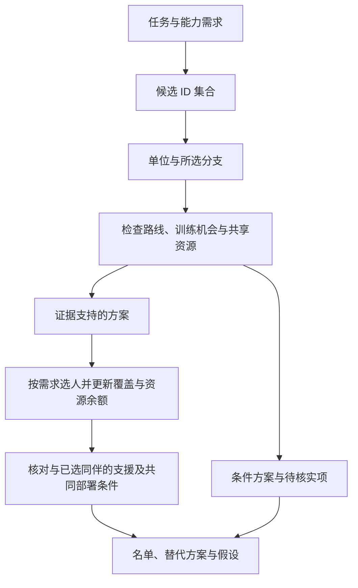

# 阵容推荐：从 ROM 到可审阅的培养与出击方案

输入 ROM 或已提取的 db。输出与问题规模相称的比较或名单，区分读取事实、计算指标与策略判断。不产出战斗模拟，不承诺通关或实际成长结果。

## 1. 先选任务范围

| 问题                 | 目标与最小工作范围                                                             |
| -------------------- | ------------------------------------------------------------------------------ |
| 谁值得培养、终盘练谁 | 比较训练后的用途与培养负担；走完整名单流程                                     |
| 谁值得出击           | 先定章节、可用人选、当前属性与能力需求；不因成长空间小排除成熟单位             |
| 两个单位谁更合适     | 只比较这两个单位的入队、属性、相关分支与约束，不做全名册审计                   |
| 两个职业有什么区别   | 比较具体 class id 的武器、移动、特殊行动、属性与技能；只有谈培养路线才查入队者 |

用户没有指定时，把“练谁”按培养任务处理。难度、路线、目标章节、名单人数 N 与能力需求按用户给定；缺失且会改变结论时询问，或明确声明采用的分析范围。N 可参考有效的 `chapters.deploy_slots` / `deploy_slots_hard` 与 `force_sortie`；字段为空或不可解释时不编造名额。

培养/轮换混合名单先为每个位置声明用途：长期培养、成熟即战轮换或无需练满的功能位。同定位的培养位使用下文终点排序；成熟轮换位优先当前/可信起始能力、免转职与较少追加训练。不要把两种排序混用成一张总榜，也不要为了凑 N 人给每人默认安排满练。

`candidates` 的 `tableStartingStats` 是单位表职业 base + 个人 delta，没有应用入队布阵/加载覆盖。先核对入队职业、等级与 autolevel；匹配时才作为入队基线比较，冲突时只称单位表情景，不作已验证入队数值排名。它也不是存档当前属性。死亡策略影响判断立场，不会自动改变数据库里的数字。

按需读取参考文件：

- 消费 JSON、选候选池、解释属性与 niche 前，读 [数据契约与推导边界](references/data-contracts.md)。
- 使用经验预算、转职道具、武器价格或技能时，读 [训练机会、资源与技能](references/resources.md) 的对应章节。
- 完整名单必须读取 [支援与队伍协同](references/supports.md)，比较名单内和同定位替代者的支援；局部比较只在伙伴组合会变化时查相关配对。

## 2. 准备证据

所有命令从仓库根跑，Node >= 22.18。以 `node src/index.ts --help` 和各命令的 `--help`、`src/repository/schema.ts` 及实际输出为准。一个 db 是一个 ROM 的可重建快照；已有可用 db 时不重复解 ROM。

完整名单先用一条 `candidates` 确认 DB 可消费并取得审计；局部问题只用需要的命令。遇到 schema 守卫拒绝时只重建一次并重新探测，不在同一个旧库上继续跑整批查询。新提取失败就保存命令、退出码和 stderr，报告阻塞；不补表、不用旧库绕过契约继续推荐。用 `&&` 或会在非零退出时抛错的进程调用串联依赖，只有 exit 0 才解析 stdout JSON。

```bash
node src/index.ts extract <rom.gba> --out <db>
node src/index.ts candidates <db>
node src/index.ts supports <db>
# 需要逐章状态或全池可达性时再运行：
node src/index.ts availability <db> --full
node src/index.ts niches <db>
```

成功输出统一为 `{ data, meta }`。数组取 `data`；诊断取 `meta.diagnostics`（DB 命令合并快照保存的提取警告与本次分析检查，去重）；`expcurve` 的预算取 `data.budgets`，参数、来源与假设取 `meta.parameters`。保留完整 JSON，控制台只展示按 ID/字段筛选的摘要；不要先打印全池 plans 或巨型 recruits 再反复翻页。执行失败时先读退出码和 stderr，不把失败当空集。

报告实际取得的 partial 诊断原文及其中的 N/M，包括从快照继承的诊断；诊断未取得或命令失败时明确说明，不填 `0/0`，也不能由空诊断断言提取完整。继承警告不表示本次重新读取或验证了该数据层。partial 可能漏掉未知指令后的事实，可达事件又可能并未触发，因此不能统称为上界或下界。

## 3. 固定候选 ID 集合

完整名单消费 `candidates.data`：`audit` 是 ID 审计，`units` 是名册与入队者并集，`playOrder` 是模型播放序。用每行 `availability.joinState` 分组；单独运行 `availability` 时规则相同：

| 状态         | 处理                                                     |
| ------------ | -------------------------------------------------------- |
| `on_route`   | 当前播放序上的已识别入队者，进入主候选池                 |
| `off_route`  | 已识别入队但不在播放序上，独立列为路线/时机待核实        |
| `unresolved` | 可能入队；按 `joinUnresolved` 说明原因，不冒充已入队候选 |
| `never`      | 当前模型未识别入队，不进入推荐池                         |

完整入队集合是 `on_route` 与 `off_route` 的并集，等价于 `joinMapIndex !== null`。SQL 只补充这些 ID 的成长、职业等事实，不再用 support 条件重新选人。连接一律使用 unit id / class id，名字只用于展示。

核对 `audit.rosterIds.length`、`joinRowCount`、`rosterWithoutJoinIds` 与 `joinersOutsideRosterIds`，无需另查名册或用 `joins` 重算。`joinIdsMissingFromAvailability`、`joinIdsMissingFromJoins`、`missingUnitIds`、`missingProjectionIds` 非空时报告证据缺口，暂停受影响候选的数值排名。名册外入队者保留；名册内未识别入队者区分 unresolved、无证据与 `availability === null`（未进入出现集合），不统称“永不入队”。

逐个检查 `baselineIssues` 和 `joinEvidence`。`class-override` / `level-override` 表示最早入队地图上存在与单位表不同的记录，包括同章互相冲突的来源；`entry-autolevel` 表示至少一条记录的 `placedAutolevel` 非零，当前投影没有应用这段入队自动成长。三类问题都暂停已验证入队数值排名，`plans` 仅留作单位表情景，不自行替换职业/等级重算。`missing-class` 时基线属性为 null、plans 为空。空 flags 只说明这些已实现检查没有报问题，不证明运行时入队属性或控制权。`joinEvidence` 合并了 normal/hard 与可达加载，不决定实际触发顺序；需要时用 `recruits` 和原始布阵核实。ally recruit + character 只是静态识别规则，不证明实机已交出控制权。

目标时点先区分 `playOrder.last` 与 `lastPlayable`；`candidates.data.playOrder.steps` 已带章节标题/编号和 normal/hard 部署数，`branches` / `closedLoop` 也在同一对象内，无需重复 SQL 拼接。必要时查 `transitions`。两者都是模型锚点，不自动等于真实终章；线性化可把互斥结局串在一起。

**先固定目标与进场/结算口径，再计算任何窗口。** 三个命令共用 `[fromPosition, beforePosition)`：`--from-position` 包含下界，`--before-position` 排除上界；都是完整播放序的 1-based position，不是章节号/map id。参数回显于 `meta.parameters.window`。例如目标 p41 进场前：

```bash
node src/index.ts candidates <db> --before-position 41
node src/index.ts availability <db> --before-position 41 --full
node src/index.ts expcurve <db> --before-position 41 --difficulty normal --actor-level 20 --actor-class-power 3
# 目标章状态单查 [41,42)，不把目标战自身经验用于证明进场已练好：
node src/index.ts availability <db> --from-position 41 --before-position 42 --full
```

区间只裁剪章状态、计数、gap 和经验预算，不改候选 ID、joinState、原入队点、plans 或完整播放序；晚于区间的 on-route 单位计数为 0、比例为 null，不因此变成 never。推荐池还要满足目标前已入队，支援交集使用同一区间。结算后情景才包含目标章；章末奖励也不能默认在本章进场可用。区间过滤不解决互斥路线。训练/轮换池可以大于单章部署数，但不能称这些人会同时出击或同时提供覆盖。

## 4. 推荐对象绑定一个分支

“方案”指一个 `unitId` 加一个选定的目标 `classId`，而非新的数据库实体。培养方案的属性、能力、技能、转职道具与时间必须来自同一条路线。

直接选择 `candidates.data.units[].plans`：每行把 `classId`、`stats`、`profile`、`promotionSteps` 和 `trainingLevels` 绑在一起。`hasFurtherPromotion` 为 true 表示还可能有后续边，当前数字不是那条更远路线的完整投影。分数与资源选择仍由本次策略计算，不把事实接口当推荐榜。



- 有转职分支时，取选定 plan 的 `stats` 和 `profile`，不逐属性拼接不同分支。
- `promotionSteps === 0` 是当前职业的投影；含义是模型没有后续转职边，不能据此断言 ROM 中绝无其他转职机制。
- 当前实现只投影最多一次转职。多级链的更远目标即使出现在 `niches`，也没有对应的完整属性投影；单列为未建模方案，不用中间职业的数字代替。
- 有直接转职目标的单位没有“不转职练满”的备选 plan。拿不到道具时，改用有证据的替代方案或列为条件推荐，不能继续按已经转职计分。
- 同一单位的互斥分支不能同时占名单位置或覆盖两个终盘职业。入队即有的舞蹈、飞行等能力仍有出击价值，只是不一定需要额外训练。
- 依赖特殊行动的选择先查 `profile.abilityFlagIds` 和个人/职业静态技能及习得表，再固定分支；`specialAction === null` 不排除 summon 等 flag 或技能授予的能力。具体查询见资源参考。飞行、Savior、杖家族仍分别不证明载运容量、运行时效果或个人装备/rank。
- 入队基线审计只看最早识别地图；若有后续交接、重载或剧情强制晋升，另核对对应记录。固定章晋升可能发生在 Lv20 前；默认20/20投影只留作理想表情景，不作为按时可达的数值。

## 5. 指标分别回答不同问题

plan 的 `stats` 在答案里称“按当前公式计算的满练属性投影”。实际公式是成长率 × 等级跨度 / 100，再分阶段应用转职加成和 cap；它不是每次成长成功的随机上界，也不保证等于截断随机过程的严格期望。实际成长可能高于或低于投影。

权重是策略选择。没有用户偏好时，可用同一向量作基线：hp 0.4、str 1.0、skl 0.8、spd 1.2、def 0.8、res 0.5、lck 0.1；明确它偏向通用战斗属性，不适合作为舞蹈、治疗等效用的完整衡量。

设 `w` 为声明过的权重，`P` 为所选分支投影，`S` 为入队属性：

| 指标             | 定义与用途                                                                                                           |
| ---------------- | -------------------------------------------------------------------------------------------------------------------- |
| `growthScore`    | `Σ(w × growth_*)`，描述成长分布，不用 `growth_total` 代替                                                            |
| `startingScore`  | `Σ(w × S)`，比较入队基线；有当前存档属性时另列来源明确的 `currentScore`                                              |
| `projectedScore` | `Σ(w × P)`，比较同定位方案的模型终点                                                                                 |
| `headroom`       | `Σ(P) − Σ(S)`，仅描述未加权的属性增量；不直接代表培养收益                                                            |
| `trainingLevels` | 优先读取 plan 同名字段；公式为 `max(0, 20 − 单位表等级) + (有一次转职 ? 19 : 0)`，是等级跨度代理，不是经验或回合成本 |
| `availableCount` | 当前播放序上可出击的剩余章数，来自 availability                                                                      |
| `windowRatio`    | 入队后可出勤比例，直接读取；20/20 与 3/3 都是 1，不能当剩余训练时间                                                  |
| `remainingExp`   | 可选：统一攻击方参数下，从入队位置起的预算和；是比较机会的指标，不是个人可分得的经验                                 |

未传区间时 availability 从入队算到播放序末尾；传区间时只统计区间内且不早于入队的可玩章。若问题是当前存档还剩多少机会，用当前章为下界、目标进场为排除上界，不直接照搬全程计数。

缺失值保持缺失，不暗填 0 或 1。不要直接用 `headroom × windowRatio` 排名，也不要直接比较成长率、章数和属性分的区间宽度。判断某轴是否改变结论时，实际比较启用前后的顺序；没有变化就说明，不制造解释。

## 6. 选择顺序与约束

先声明所需能力及优先顺序，例如舞蹈、治疗、飞行运输、物理输出。能力来自武器、移动、特殊行动与已验证技能；稀有但没有任务用途的 niche 不自动优先。没有明确需求时给分定位推荐，不伪造跨定位的统一战力榜。

1. 先按路线、入队时间及资源证据分成“证据支持”和“条件推荐”。证据支持只指已检查的前提，不等于保证练满。
2. 按声明的能力需求顺序选人。同定位培养方案的默认排序键为 `projectedScore` 降序、`trainingLevels` 升序、`startingScore` 降序、`growthScore` 降序，最后 unit id / class id 升序。它是终点与培养负担的启发式，不宣称最优成本收益；改规则或权重须声明。
3. 出击任务用当前能力与 `currentScore`，只有入队基线时用 `startingScore` 并标明限制；成长空间小不是淘汰理由。非战斗定位按声明的能力需求比较，不强行套用战斗属性分。
4. 每选一人就固定分支，更新共享道具、购买支出、新增能力及与已选同伴的支援边。资源冲突时替换分支/单位或将方案降为条件推荐，不能只在文末免责后继续计算完整覆盖。
5. 用 `availableCount`、实际 gap 与必要时的 `remainingExp` 检查训练机会。经验预算排除了杖和舞蹈等来源，且不能保证个人份额；无法证明训练可完成时保留条件，不臆造训练进度。
6. 对同定位替代与整队调整，检查真实配对、共同出勤、培养进度、可用加成和站位代价。已实现或条件充分的支援可以改变选择；未验证的满级支援不进入个人属性投影，也不能自动盖过必要能力或资源约束。实际比较考虑支援前后的选择，没改变就说明，缺证据不填零收益。
7. 停在声明的 N 人或需求已满足处，报告未覆盖项与继续扩员的理由。边际覆盖只计选定分支在目标时点能提供的新能力；没有新增能力的人仍可能提供输出、容错、支援或轮换价值。

`niches.joinerCount` 是全池、最多四步转职可达性的线索。对当前路线/时点的稀缺性，应统计满足条件方案里的不同 unit id，并说明范围。`classCount` 是职业条目数，不能作为独占能力的必要条件；同名重复职业不应改变能力优先级。

## 7. 输出与交付前检查

完整名单包含：

1. **分析范围**：培养或出击、路线、难度、目标时点、N 与依据、能力需求优先序。
2. **名单与理由**：单位、选定 class id / 分支、能力、起始/当前属性依据、相关分数、培养等级跨度与训练机会；每人的位置由哪些证据决定。
3. **约束与替代**：道具分配、可得时点、采购数量与累计花费；条件方案与无投影/无窗口项单列。
4. **支援取舍**：关键配对、已达等级或目标情景、共同出勤与站位条件、加成证据、培养与等级额度分配，以及是否改变同定位人选；缺少规则或加成时明确未定，不凭空承诺全 A 支援。
5. **覆盖增量**：按已选分支报告逐人或若干前缀的新增能力、缺口与重复用途。不把贪心选择称为最小覆盖或最优阵容。
6. **假设与限制**：各位置的培养/轮换用途、权重与排序键、目标进场或结算口径、成长投影语义、技能是否计分、取得的诊断；使用区间或 expcurve 时附相关 `meta.parameters`。未检查的完整性写“未检查”，不能填 0。死亡策略只说明其实际影响。

局部比较只输出相关差异、推荐条件与缺失证据，不强制生成全名册覆盖表。

交付前确认：数字来自本次命令或查询；SQL 没有改变候选集合；分支、属性和覆盖一致；同一资源未重复分配；未将可达事件当必然收益；未将投影当成长上界；支援没有忽略共同部署、进度或共享等级额度。仓库改造提案不属于推荐流程，不在执行此技能时顺带修改 schema 或分析算法。
